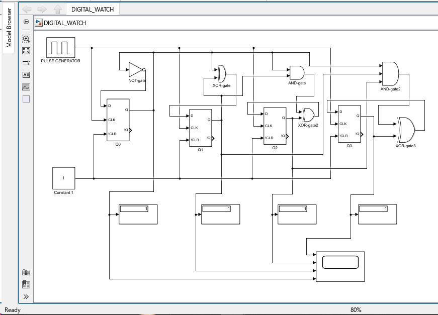
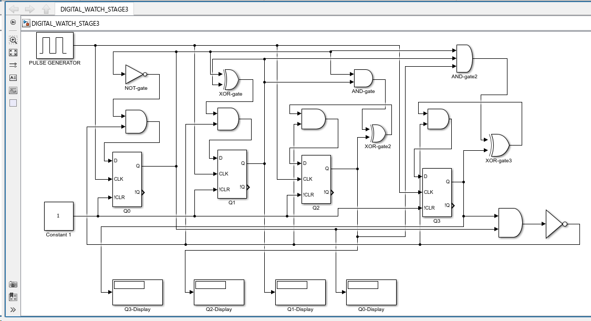
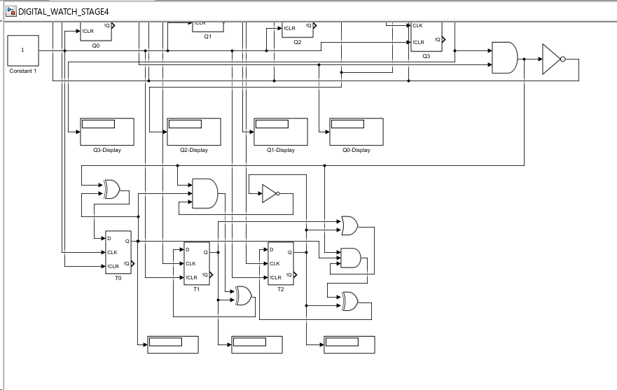
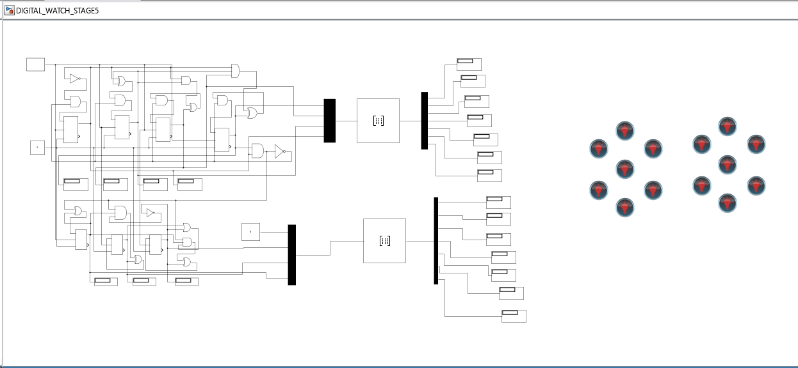
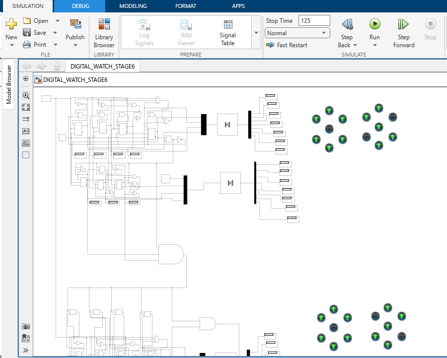
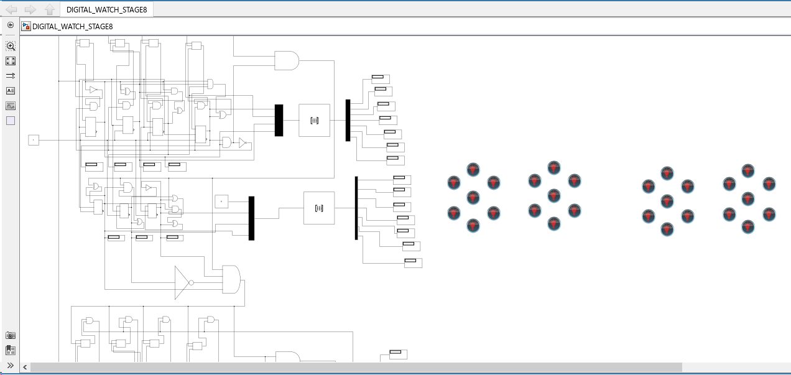
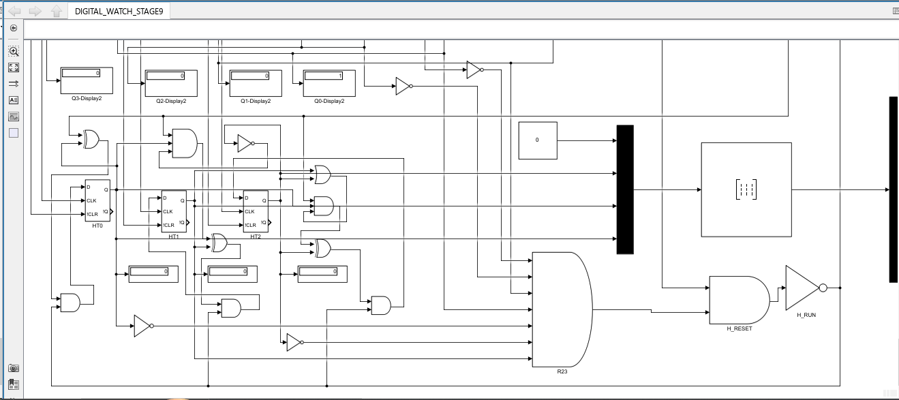
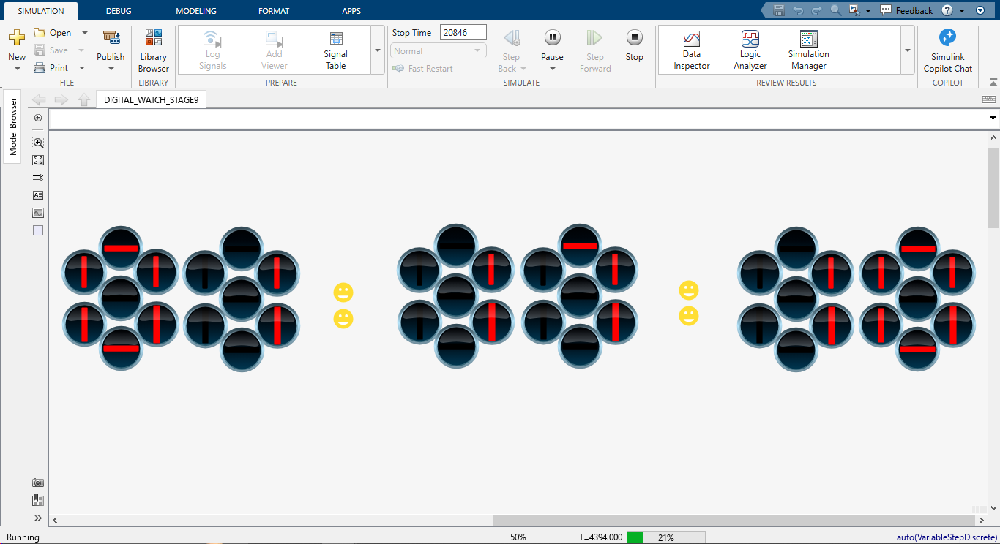

# 24-Hour Digital Watch in MATLAB Simulink

[](https://www.mathworks.com/products/matlab.html)
[](https://www.mathworks.com/products/simulink.html)
[](LICENSE)
[](#project-overview)

A gate-level **24-hour digital watch simulation** built in **MATLAB Simulink**. The model counts seconds, minutes, and hours, converts BCD digit values into seven-segment control signals, and drives a six-digit `HH:MM:SS` dashboard display.

The project was developed as a hands-on digital electronics exercise: starting with an individual AND gate, building synchronous binary counters from D flip-flops and logic gates, cascading modulo counters, and finishing with BCD-to-seven-segment decoding and custom rectangular lamp graphics.

> **Project type:** educational engineering simulation. This repository describes and documents a Simulink model; it is not a manufactured or hardware-validated wristwatch.

## Project overview

The watch uses one shared simulated 1 Hz clock source. Three coordinated counter sections maintain the time:

| Section | Range | Function |
|---|---:|---|
| Seconds | `00–59` | Advances once per simulated second |
| Minutes | `00–59` | Advances when the seconds counter rolls over |
| Hours | `00–23` | Advances when the minutes and seconds complete an hour; rolls over after 23 |

The six decimal digits are presented as a 24-hour `HH:MM:SS` display.

## Features

- **Shared master clock:** one Pulse Generator supplies the clock input to the seconds, minutes, and hours flip-flops.
- **Gate-level synchronous counters:** individual D flip-flops are combined with NOT, AND, OR, XOR, and NAND logic.
- **Modulo-10 units counters:** each decimal units digit counts from 0 through 9 and returns to 0.
- **Modulo-6 tens counters:** seconds and minutes tens digits count from 0 through 5.
- **Cascaded timekeeping:** seconds rollover enables the minutes counter; minute rollover enables the hours counter.
- **24-hour rollover:** dedicated terminal-state logic returns the display from `23:59:59` to `00:00:00`.
- **BCD-to-seven-segment decoding:** Simulink Combinatorial Logic blocks use truth tables to generate the seven segment signals (`a` through `g`).
- **Vector-based decoder wiring:** Mux and Demux blocks group BCD inputs and separate the seven segment outputs.
- **Custom dashboard display:** Dashboard Lamp indicators are styled with custom SVG segment artwork for horizontal and vertical rectangular segments.
- **Real-time observation:** Simulink Simulation Pacing can be enabled to watch the counter progress at approximately one simulation second per wall-clock second, or disabled for faster verification runs.

## System architecture

```text
                         SHARED 1 Hz PULSE GENERATOR
                                    |
                   +----------------+----------------+
                   |                |                |
                   v                v                v
             +-----------+    +-----------+    +-----------+
             | SECONDS   |--->| MINUTES   |--->| HOURS     |
             | 00 to 59  |    | 00 to 59  |    | 00 to 23  |
             +-----------+    +-----------+    +-----------+
                   |                |                |
                   v                v                v
             BCD decoders     BCD decoders     BCD decoders
                   |                |                |
                   v                v                v
              7-segment        7-segment        7-segment
              indicators       indicators       indicators
                   |                |                |
                   +----------------+----------------+
                                    |
                               HH:MM:SS
```

### Counter design

Each decimal units digit is a four-bit counter built from D flip-flops and combinational feedback logic. The units counter wraps at decimal 9. A carry/enable condition advances the corresponding tens digit. The tens digit is limited to decimal 0–5 for seconds and minutes.

The hours section uses its own enable and carry logic, plus a terminal-state detector for decimal 23. At the next hour-enable event, the hours state is synchronously driven back to zero, producing the 24-hour rollover.

### BCD-to-seven-segment decoding

Each decimal digit is represented by a four-bit BCD input. A Combinatorial Logic block maps the BCD input to seven outputs:

| Output | Physical segment position |
|---|---|
| `a` | Top |
| `b` | Upper right |
| `c` | Lower right |
| `d` | Bottom |
| `e` | Lower left |
| `f` | Upper left |
| `g` | Middle |

For three-bit tens counters, a Boolean zero is supplied as the most-significant BCD input. The seven decoder outputs are separated with a Demux and connected to the corresponding Dashboard Lamp indicators.

## Verified simulation results

The following values were observed during development and verification of the model. Times are elapsed simulation seconds from the initial zero state.

| Elapsed simulation time | Expected displayed time | Observed result |
|---:|---:|---|
| 59 s | `00:00:59` | Seconds units/tens reached 9 and 5 |
| 60 s | `00:01:00` | Seconds rolled over; minutes advanced |
| 180 s | `00:03:00` | Confirmed |
| 1,000 s | `00:16:40` | Minutes = 16; seconds = 40 |
| 3,600 s | `01:00:00` | Hours units = 1; hours tens = 0 |
| 43,200 s | `12:00:00` | Hours units = 2; hours tens = 1 |
| 82,800 s | `23:00:00` | Hours units = 3; hours tens = 2 |
| 86,400 s | `00:00:00` | 24-hour rollover confirmed |

The raw flip-flop Display blocks in the model were sometimes arranged least-significant-bit first (for example, `Q0`, `Q1`, `Q2`, `Q3`). The table above reports the human-readable decimal time, not the physical left-to-right order of those raw bit displays.

## Screenshots

The screenshots below are development captures showing the progression from the binary counter through the integrated watch. Some captures show an earlier Dashboard Lamp appearance; the final model was subsequently restyled with rectangular custom SVG segments.

### 1. Four-bit synchronous binary counter



### 2. Modulo-10 units counter



### 3. Modulo-6 tens counter



### 4. BCD-to-seven-segment decoder



### 5. Cascaded seconds and minutes sections



### 6. Six-digit display layout



### 7. Hours 23 rollover logic



### 8. Integrated watch simulation



## Requirements

The development environment reported for this project was:

- MATLAB **R2026b Update 1** (Version 26.2)
- Simulink **Version 26.2**
- Windows 10 Pro

The model uses standard Simulink libraries and blocks, including:

- Pulse Generator and Constant
- D Flip-Flop (from the Simulink Extras flip-flop library in the development environment)
- Logical Operator
- Switch
- Mux and Demux
- Combinatorial Logic
- Display and Scope
- Dashboard Lamp

Block availability and dashboard appearance can vary by MATLAB/Simulink release. A compatible MATLAB and Simulink installation is required to open and run the `.slx` model. No MATLAB installation or MathWorks software is included in this repository.

## Getting started

1. Install and activate a compatible MATLAB and Simulink release.
2. Clone or download this repository.
3. Copy your final model file, `DIGITAL_WATCH_STAGE9.slx`, into the `models/` directory. The model file is not included in this documentation bundle; add the final `.slx` file from your own working directory before publishing the repository as a runnable project.
4. Open MATLAB and set the repository folder as the current working directory.
5. Open `models/DIGITAL_WATCH_STAGE9.slx`.
6. Run the model. Use Simulation Pacing when you want to observe the digits changing in real time. Turn pacing off when you want to run long-duration verification tests quickly.

The two SVG files in `assets/` are the horizontal and vertical rectangular segment artwork used for the customized Dashboard Lamp appearance. If the model references SVG files by absolute path, update those references to the repository's `assets/` directory or reselect the corresponding files in the Lamp design settings.

## Suggested repository layout

```text
simulink-digital-watch/
├── README.md
├── LICENSE
├── .gitignore
├── GITHUB_METADATA.md
├── assets/
│   ├── segment_horizontal.svg
│   └── segment_vertical.svg
├── models/
│   └── DIGITAL_WATCH.slx
│   └── DIGITAL_WATCH_STAGE3.slx
│   └── DIGITAL_WATCH_STAGE4.slx
│   └── DIGITAL_WATCH_STAGE5.slx
│   └── DIGITAL_WATCH_STAGE6.slx
│   └── DIGITAL_WATCH_STAGE7.slx
│   └── DIGITAL_WATCH_STAGE8.slx
│   └── DIGITAL_WATCH_STAGE9.slx
|    
├── screenshots/
│   ├── 01-four-bit-synchronous-counter.png
│   ├── 02-mod10-units-counter.png
│   ├── 03-mod6-tens-counter.png
│   ├── 04-bcd-seven-segment-decoder.png
│   ├── 05-seconds-and-minutes-modules.png
│   ├── 06-six-digit-layout-planning.png
│   ├── 07-hours-23-rollover-logic.png
│   └── 08-integrated-watch-simulation.png
└── 
```

## Engineering concepts demonstrated

- Boolean algebra and combinational logic
- Sequential logic and edge-triggered D flip-flops
- Synchronous counters and state transitions
- Modulo-10 and modulo-6 counting
- Cascaded counters and carry/enable signals
- BCD representation and seven-segment decoding
- Truth-table-based logic implementation
- Signal routing with Mux and Demux blocks
- Simulation pacing, waveform observation, and test-case verification
- Reusable digital subsystem design

## Limitations and possible next steps

This is a behavioural/discrete-time simulation. Its Pulse Generator represents an ideal one-pulse-per-second timing source; it is not a physical quartz oscillator or a calibrated real-time clock. The model does not, by itself, account for oscillator tolerance, electrical noise, power consumption, battery behaviour, display-driver current, PCB layout, environmental effects, or hardware timing limits.

Possible extensions include:

- Start, pause, stop, and reset controls
- Manual time-setting inputs
- Alarm and stopwatch modes
- A cleaner top-level model built from reusable Seconds, Minutes, and Hours subsystems
- Hardware-oriented implementation using appropriate microcontroller or programmable-logic tools

## License

This project is released under the **MIT License**. See [`LICENSE`](LICENSE).

The MIT license applies to the original project materials in this repository that the author is entitled to license. MATLAB, Simulink, MathWorks libraries, and other third-party software or components remain the property of their respective owners and are subject to their own license terms. This repository does not include or grant a license to MathWorks software.